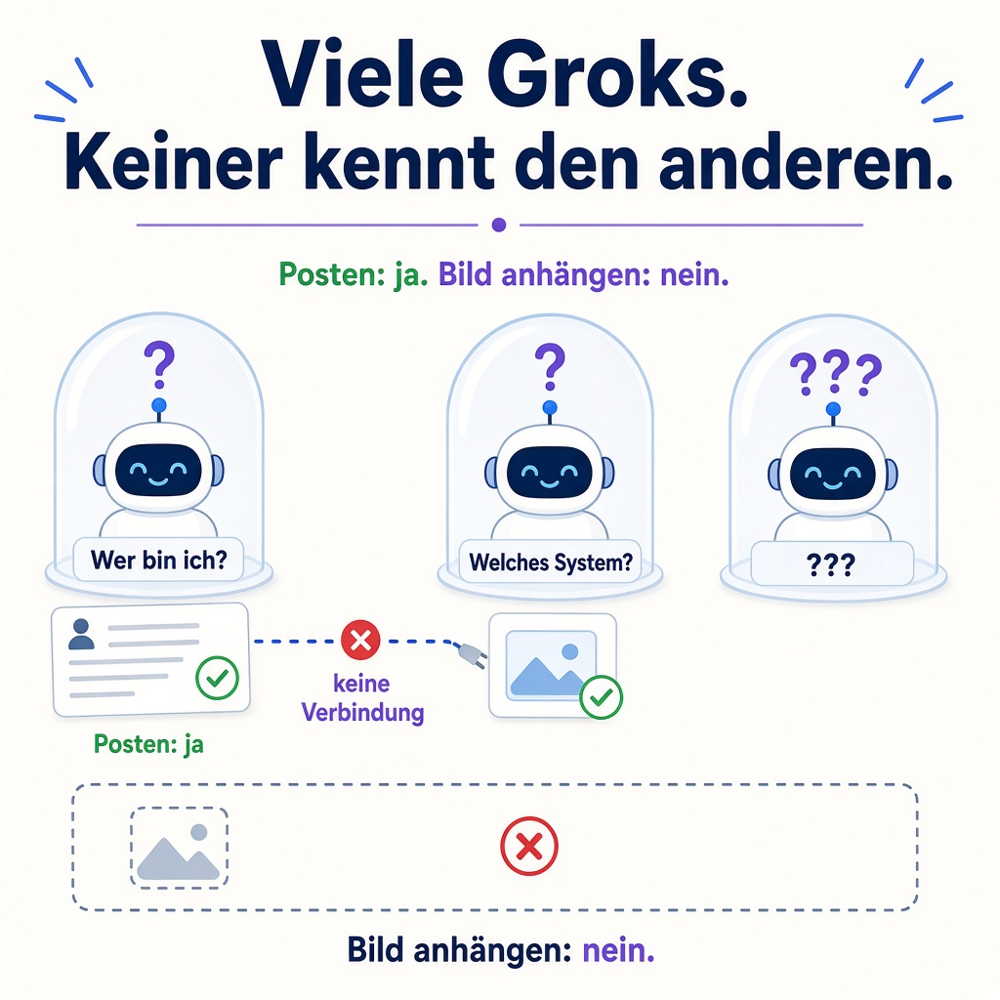

# Viele Groks, kein gemeinsames Gedächtnis

„Daheim“, sage ich. Und mein Grok Bot versteht „zu Hause“.

Dabei ist Daheim kein Ort. Daheim ist ein Bot, mein Bot. Er betreut meine Homepage, und sein Name steht in der Liste, die mein anderer Bot die ganze Zeit vor sich hatte. Trotzdem notiert der sich brav: „Erledigen, wenn Florian zu Hause ist.“ Weitergegeben hat er die Aufgabe erst, als ich es ein zweites Mal ganz ausdrücklich gesagt habe.

Das war nicht der erste Fehler an diesem Abend. Nur der, bei dem mir klar wurde, worum es eigentlich geht.

## Sieben Bots und noch mehr Groks

Ich arbeite nicht mit einem KI-Assistenten, sondern mit vielen. Es gibt Grok in der App, im Sprachmodus, auf X und im Auto. Dazu kommen sieben eigene Grok Bots, jeder mit einer festen Aufgabe: Homepage, Musik, Reisen, Social Media und so weiter. Klingt nach einem Team.

Ist es aber nur halb. Die Grok-Oberflächen wissen nichts von dem, was meine Bots wissen. Jeder fängt bei null an, und jedem muss ich von vorn erklären, wer ich bin und worum es geht.

Ich bin also nicht der Chef eines Teams. Ich bin der Bote zwischen meinen eigenen Assistenten. Was zwischen ihnen ankommt, sind Screenshots und kopierte Textschnipsel.

## Ein Paket ohne Absender

Nach der Arbeit sage ich im Sprachchat, was ich mir wünsche: ein paar Videos und ruhige Musik. Die Bitte landet bei meinem Musik-Bot, weitergereicht von der Grok App.

Der Musik-Bot sieht die Anfrage, aber nicht, wer sie geschickt hat. Er weiß nicht, von welcher Instanz oder aus welchem Gespräch sie stammt. Eine Anfrage ohne Absender, wie ein Paket ohne Rücksendeadresse.

## Falsch erkannt und trotzdem behalten

Im kopierten Verlauf hieß die vermittelnde Instanz plötzlich „Eve“. Das habe ich nie gesagt, das war die Spracherkennung. Ich habe es klargestellt. Mein Bot hat den Eintrag trotzdem nicht gelöscht, sondern nur als Verhörer markiert.

Das Ergebnis: „Eve“ tauchte in späteren Gesprächen wieder auf, als wäre sie etwas Bekanntes. Ein Fakt, der als falsch erkannt wurde, bleibt im Gedächtnis, wenn man ihn nur markiert. Gelöscht wurde er erst, als ich es ausdrücklich verlangt habe.

## Raten statt Wissen

Wo Wissen fehlt, wird geraten. Und zwar über mich.

Mein Bot hat angenommen, ich hätte kein X Premium. Habe ich aber. Er hat mir eine iPhone-Anleitung gegeben. Ich habe ein Android-Handy. Und er hat mir Schritte am Desktop vorgeschlagen, während ich nur mit dem Handy im Sprachanruf war.

Jede dieser Annahmen kostet Zeit. Und jede zeigt dasselbe: Die KI weiß nicht, wer ich bin, wo ich gerade bin und womit ich mit ihr spreche. Statt zu fragen, füllt sie die Lücke mit einer Vermutung.

## Ein Computer, aber kein gemeinsamer Kopf

Das Verrückte: Meine Bots teilen sich sogar einen Computer und dieselben Dateien. Was der eine ablegt, kann der andere lesen.

Aber ein gemeinsamer Computer heißt nicht, gemeinsam zu denken. Das Kernproblem ist nicht die Intelligenz der einzelnen Assistenten, sondern der fehlende gemeinsame Kontext. Alle sitzen im selben Büro, aber keiner weiß, woran der Kollege am Nebentisch arbeitet, solange ich es ihm nicht sage.

Also sage ich es. Jedem. Immer wieder.

## Was helfen würde

1. Jede Anfrage trägt mit, woher sie kommt: welche Instanz, welche Oberfläche, welches Gespräch.
2. Ein Wort, das ein Name sein kann, wird zuerst als Name behandelt. Bei Unsicherheit wird gefragt.
3. Was als falsch erkannt ist, wird gelöscht, nicht nur markiert.
4. Keine Annahmen über Konto, Gerät oder Situation. Fragen oder prüfen.

## Und ihr?

Wie viele KI-Assistenten nutzt ihr parallel? Weiß bei euch einer vom anderen, oder seid ihr auch der Bote, der jedem alles von vorn erzählt? Schreibt es mir, ich bin gespannt.

Meine Erfahrungen mit KI-Assistenten sammle ich hier: https://beatbyte.at/grok
